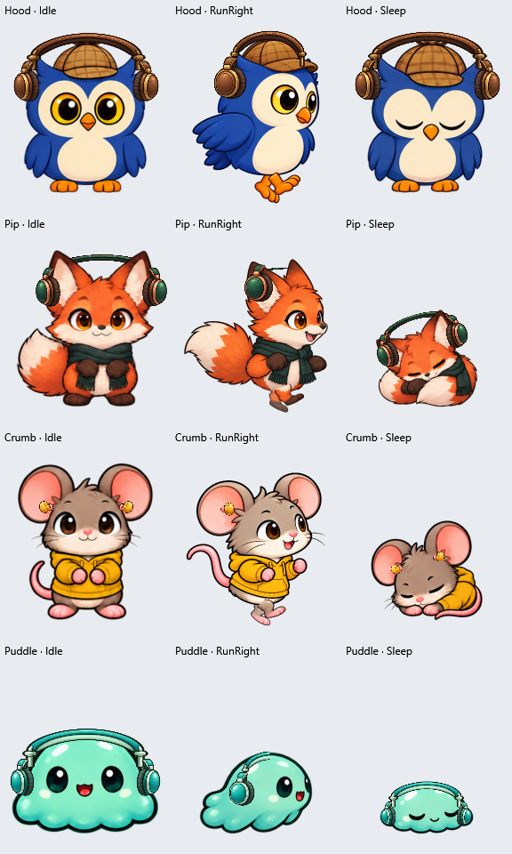

# Painted headphone sprite parts

`headphones.png` is an original AI-generated transparent part atlas (built-in image-generation tool, 2026-10-12). It contains three parts per pet: oblique exterior cup, profile exterior cup, and band. The four rows are Hood, Pip, Crumb, and Puddle. The supplied owl image informed headphone anatomy; its character, coffee cup, and watermark are not included in this asset.

`poses.json` supplies native-pixel crop rectangles and calibrated placement for each source animation column. Runtime layers are clipped to the existing 192 x 208 logical canvas. Front cups sit outside the facial features; side views show the cup behind the face and occlude the far side. Hood's full curved band is drawn in front of his hat, with its crown fitted just above the cap, following the user's later marked reference. This replaces his initial under-hat layering.

The fitted poses place Hood's and Pip's cups higher at their animal ears, with additional lift while walking. Crumb now uses small wireless in-ear buds, positioned near the inner ear bases with no band. His two sprite parts come from `crumb-earbuds.png`; the Crumb over-ear row in the original atlas is retained as source history and is not used at runtime.

To regenerate placement after deliberately changing the built-in atlases, run `powershell.exe -NoProfile -ExecutionPolicy Bypass -File tools/Generate-HeadphonePoses.ps1`. The generator measures the actual opaque top of each frame and combines that with the explicit hand-fitted rig tuples. Update those tuples and inspect all rendered poses when changing character anatomy; copying an atlas or changing animation columns without calibrating the rig is insufficient. The source crop rectangles must also be updated if the headphone part layout changes.

Crumb's chubby Cozy artwork was replaced on 2026-10-16. His fitting now measures the saturated pink inner-ear regions in every packed frame, keeps clearance around each bud and follows the ear tilt. Head turns hide an occluded far bud; walking retains the inward-facing rose tip. Hood and Puddle retain their existing fitted poses. See [Crumb's current earbud preview](../../docs/previews/pet-animations/crumb-earbuds.png).

Pip's cartoon quadrupedal artwork was replaced on 2026-10-16. His 145 calibrated poses follow the new cream inner ears, including the lower walking profile, head turns, ground-bowl feeding and canine stretch. Partly hidden far ears are occluded. `Assets/Pip/source/headphone-fit.json` retains the fit and atlas SHA-256; the generator rejects a changed atlas until recalibrated. His existing green/copper headphone parts and behind-head band layering are retained. See [Pip's headphone preview](../../docs/previews/pet-animations/pip-headphones-preview.png).

Walking places each bud 12 logical pixels below its measured inner-ear anchor, nearer the ear entrance as shown in the user's marked reference. This adjustment applies to both walking directions and leaves other poses unchanged.

No sound detection or audio-volume behavior is defined by these files. They are embedded in the Windows application and decoded once, with cached frame drawings. Missing/invalid artwork produces a local warning and leaves ordinary pet art usable. Sprite generation prompts and this README are source documentation and are not bundled with the user guides.



## Crumb earbud generation prompt

`crumb-earbuds.png` is an original transparent PNG generated with the built-in image-generation tool on 2026-10-12 and copied unchanged into this folder. Its actual dimensions are 1774 x 887. The two visible part crops (with transparent padding) are [238,223,484,417] and [1098,228,432,412]. The mouse reference supplied character/style guidance; the existing headphone atlas supplied color/painting guidance. Neither was an edit target.

```text
Create an original transparent PNG sprite-parts atlas containing exactly TWO isolated small wireless IN-EAR earbuds for a chibi mouse desktop pet named Crumb. The mouse image is a character/style reference only; do not draw the mouse or any body parts. The existing accessory atlas is a color/paint style reference only; do not reproduce its over-ear cups or bands.

Output: landscape 1024 x 512 canvas, two equal cells side by side. LEFT CELL: one compact left in-ear bud viewed obliquely from the front, with a small rose silicone tip pointing inward to the right, rounded mustard yellow/gold outer bean-shaped shell facing left/front, tiny softly painted highlight, warm dark ink outline. RIGHT CELL: the same bud viewed in side profile with the little rounded gold exterior shell facing the viewer and a subtle rose inner tip behind its edge. Every bud is upright and centered in its own cell, contained approximately within x=120..390, y=120..390 for the left and x=632..902,y=120..390 for the right, with generous genuinely transparent margins.

This is a tiny earbud inserted in the mouse's ear, NOT a padded over-ear cup. No headband, no ear loop, no microphone, no stem, no wire, no large cushion, no animal ears, no earbud case, no character, no text or logos, no ground shadow, no backdrop. Silhouette should read as a compact comfortable bean-like in-ear bud, simply shaded, harmonious mustard gold and warm rose. Painted anime/chibi game sprite art, clean dark outlines, soft cel shading, rounded dimensional forms matching the reference mouse. The earbud will display at only 12 to 16 logical pixels high so keep it simple and readable, no tiny decorations. Preserve genuine alpha transparency around both isolated parts.
```

## Original over-ear generation prompt

The input character references were their ordinary front sprites. The user's owl-with-headphones illustration was the anatomy reference. The built-in tool was called with transparent background enabled and this prompt:

```text
Create a production transparent PNG sprite-parts atlas for a desktop pet game. The four character images are STYLE REFERENCES only; do not draw any character. The last owl-with-headphones photo is an ANATOMY reference only: real over-ear headphones sit vertically against the SIDES of a head, with padded cups, outer shells, and a curved band. Make original accessory art, no copied logos or watermark.

Exact composition: portrait 1024 x 1536 atlas, FOUR equal-height rows and THREE equal-width columns, TWELVE separately isolated sprite parts, centered in their cells with generous transparent margins and no part crossing a cell boundary. No labels, text, boxes, characters, complete headsets, floor shadows, or backdrop. Genuine transparent background.

Rows in this exact order:
1. Hood owl: warm walnut brown leather and muted antique brass, suitable for his detective cap.
2. Pip fox: deep forest green leather and restrained copper trim, matching his scarf.
3. Crumb mouse: mustard gold shell, warm rose padding accents, matching his yellow hoodie.
4. Puddle slime: ocean teal shell and pale mint trim, matching his translucent mint body.

Columns in this exact order, for EACH row:
1. A SINGLE LEFT EAR CUP for a FRONT-facing character, viewed obliquely from the front (about 65 degrees away from the cup's outer-face normal). A narrow vertical ellipse with a visibly rounded, shaded outer shell on the left and a dark soft cushion on its right INNER edge; a small attachment hinge on top. This is seen from the side of a face, never laid flat on top of a head. Its outward-facing shell is visible in perspective; DO NOT show a cream cushion pad facing the viewer.
2. A SINGLE NEAR EAR CUP for a SIDE-profile character, with the exterior shell facing the viewer. A fuller vertical oval/circular three-quarter silhouette, soft thick dark cushion visible along one side, top hinge, inset outer shell panel and thin metal ring. This is a physical ear cup, not a button or a flat rounded rectangle.
3. ONLY the curved HEADBAND, WITHOUT cups: a wide upside-down U-shaped padded leather strap, arching left-to-right, with matching thin metal sides and short exposed sliding stems downward at both ends. Empty transparent center, open bottom. Rounded hand-painted highlights and shaded thickness. This piece will render behind a character and may be occluded by a hat.

Medium/style: finished anime/chibi game sprites with dark warm ink outlines, softly painted cel shading, warm directional highlights, rounded dimensional forms and subtle leather texture. Match the illustration quality and line weight of the character references. Avoid flat UI icons, vector-looking concentric rectangles, photorealism, extreme gloss, jagged pixel art, microphones, dangling wires, oversized decorative symbols. Keep every part unrotated and upright. Cup outer faces should be convincingly dimensional, with harmonious restrained highlights and small shaded hinge detail. All twelve components must be cleanly isolated with alpha transparency, sharp readable silhouettes, no semi-transparent haze around cells.
```

