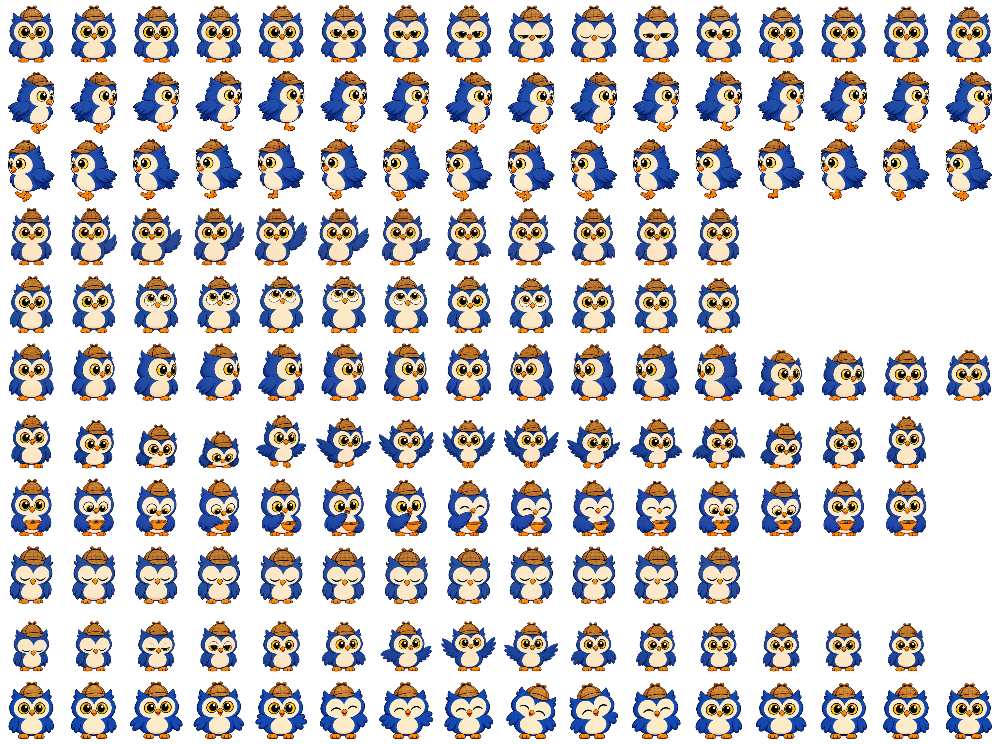

# Hood animation set

The transparent sprite sheet uses 384x416 pixel cells displayed at 192x208 logical units through `spriteScale: 2`. All motion bounds stay in logical units, so higher artwork resolution does not change Hood's size, placement, or minimum roaming area.

The preview shows each unique pose, with rows in playback order:

| Action | Row | Unique poses | Frame interval | Playback |
| --- | --- | --- | --- | --- |
| Idle | 0 | 16 | 80 ms | 7.84-second neutral hold, then a 1.2-second gentle blink; loops every 9.04 seconds (about 20% more often). |
| Run right | 1 | 16 | 55 ms | Alternating feet with a restrained body bounce; loops every 880 ms. |
| Run left | 2 | 16 | 55 ms | Mirrored right-running stride; loops every 880 ms. |
| Wave | 3 | 12 | 78 ms | Completes in 936 ms. |
| Look up | 4 | 12 | 78 ms | Completes in 936 ms. |
| Look around | 5 | 16 | 143 ms | Completes in 2288 ms. |
| Jump | 6 | 15 | 80 ms | Crouch, vertical jump, and soft landing; completes in 1200 ms. |
| Feed | 7 | 15 | 60 ms | Completes in 900 ms; Hood takes a seed from his bowl. |
| Sleep | 8 | 12 | 225 ms | Gentle closed-eye breathing; loops every 2700 ms. |
| Wake | 9 | 15 | 60 ms | Completes in 900 ms, ending with eyes open. |
| Pet | 10 | 16 | 120 ms | Happy attention response; completes once in 1920 ms. All four pets have their own artwork. |

Each sequence uses columns zero through its unique-pose count minus one. Idle additionally repeats column zero 120 times at the beginning to provide a quiet hold; playback skips 23 of those repeated frames to shorten the pause while preserving the manifest and saved frame indices. Head tilts are confined to deliberate reactions instead of the idle loop. Roaming retains eight-second bouts and its travel speed. Boredom scales bout frequency linearly from 10% to 120% of the previous once-per-40-seconds cadence. At fixed boredom 0, 50, and 100, the idle rests are approximately 392, 53.5, and 25.3 seconds respectively; increasing boredom brings the next bout forward during the current rest. Sleep, dragging, area editing, and other actions pause roaming.

Click and spontaneous jumps use the same 90-logical-unit lift (about half Hood's visible height). Preparation and landing stay at the original position; the airborne phase follows a smooth arc and pauses horizontal roaming. Jumps may rise above the roaming area, but lift is reduced where the current monitor's usable top edge limits clearance. The saved position and roaming area stay fixed, including when saving mid-jump.

Wave, look around (left/right), look up, and jump are spontaneous reactions controlled by the random-events setting. Settings exposes the minimum and maximum wait in minutes, defaulting to 1–5 active awake minutes, equally during idle and roaming. Sleep, dragging, area editing, and other reactions pause the countdown; each gesture completes once before returning to rest.

To replace the artwork or change its frame layout, follow [changing sprites](changing-sprites.md).
