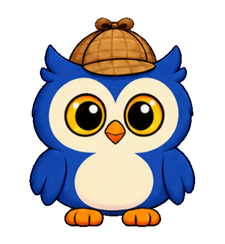

# Hood: Pet attention preview

Animation for **Pet**, directly below **Feed**. Selecting it triggers one short happy gesture: perk up, happy crescent eyes, a small wing flutter and sway, then return to idle.

The example action lasts approximately 1.92 seconds, compared with the current 0.9-second feeding action. The GIF includes a 1.2-second pause between repeats for viewing. It uses 16 poses on a 384x416 canvas, suitable for previewing at the existing 192x208 logical display size.

The animation is integrated as **Pet**, directly below **Feed**, and is now the only action that reduces boredom. `source.png` is the unmodified generated source, `poses.png` shows the normalized preview poses, and `prompt.txt` records the exact built-in imagegen prompt. The references were the existing `Assets/Hood/source/v3/idle.png` and `feed.png` artwork.
