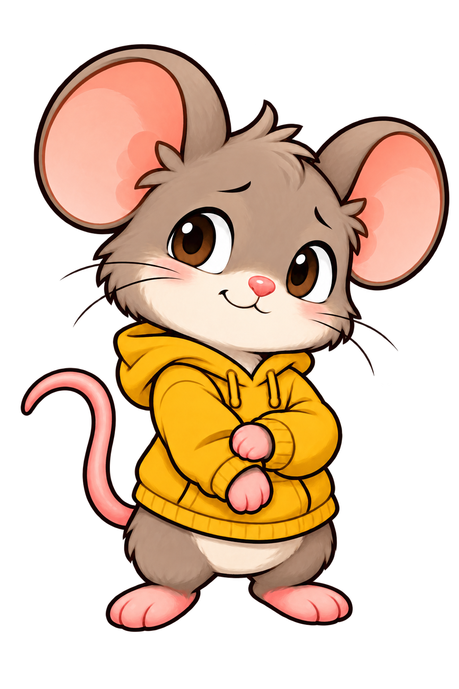
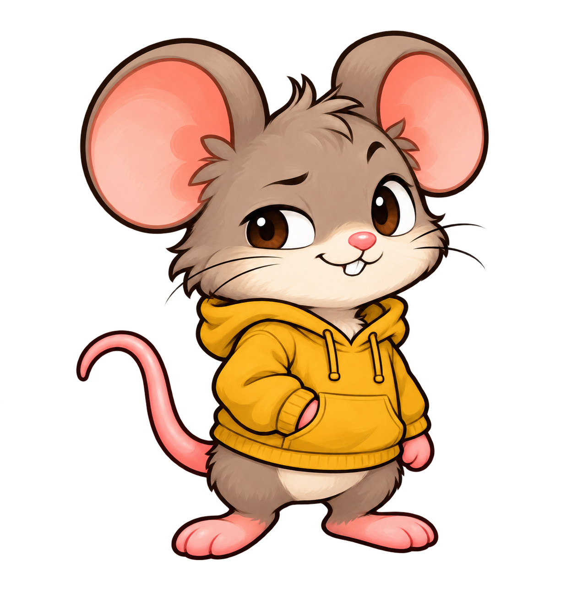
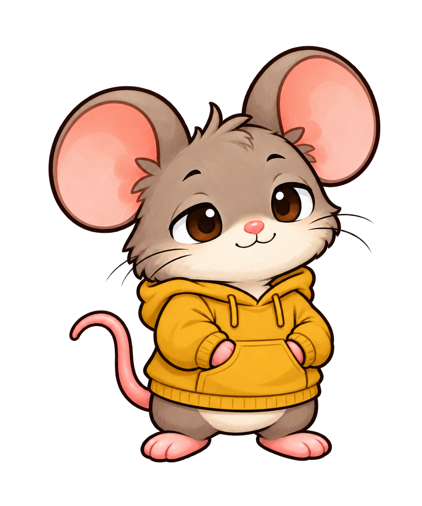
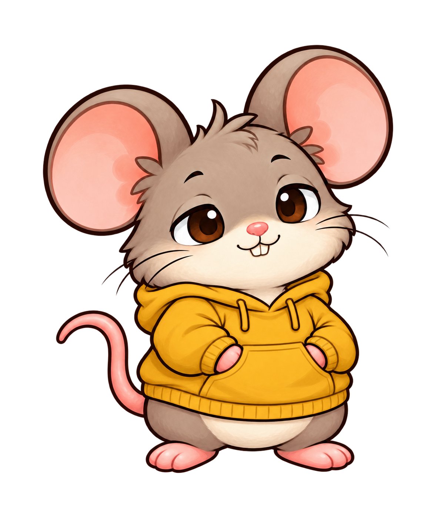
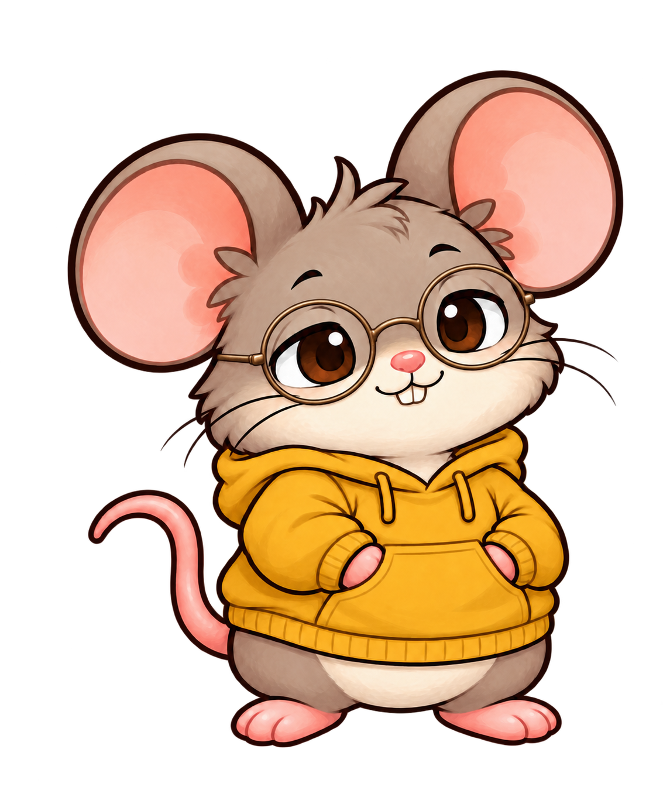

# Crumb base sprite ideas

Three static concepts generated with the built-in imagegen tool on 2026-10-16. All retain Crumb's mustard hoodie; each explores a different expression and stance. These are design ideas, without animations or runtime integration.

| 1. Curious | 2. Cheeky | 3. Cozy |
| --- | --- | --- |
|  |  |  |
| Shy smile, tilted head, paws holding a cuff. | Raised brow, crooked grin, one paw in his pocket. | Relaxed eyelids, soft smile, both paws in his pocket. |

Source reference: `Assets/Crumb/source/reference.png`. Exact generation prompts: [prompts.md](prompts.md).

## Cozy refinement

Selected direction: Cozy Crumb, with fuller cheeks and belly and a small pair of visible mouse incisors. Same relaxed expression, mustard hoodie, and pocket pose; still a single static concept.

[Exact refinement prompt](04-cozy-chubby-prompt.md).

This chubby baseline with the original tuft and no glasses is now the runtime Crumb design. See the [animations and sprite atlas](../../pet-animations/README.md); hairstyle and glasses variants below remain unused concepts.

## Hairstyle variations

Three hairstyle edits of the updated chubby Cozy Crumb, preserving his teeth, expression, hoodie, pose and proportions.

| Tousled bedhead | Swept fringe | Soft curls |
| --- | --- | --- |
|  |  |  |

[Exact hairstyle prompts](hairstyle-prompts.md), generated with the built-in imagegen tool.

## Glasses variations

Original hairstyle retained, using `04-cozy-chubby.png` as the base for all three static glasses concepts.

| Round wire frames | Rounded square frames | Small oval frames |
| --- | --- | --- |
|  |  |  |

[Exact glasses prompts](glasses-prompts.md), generated with the built-in imagegen tool.

