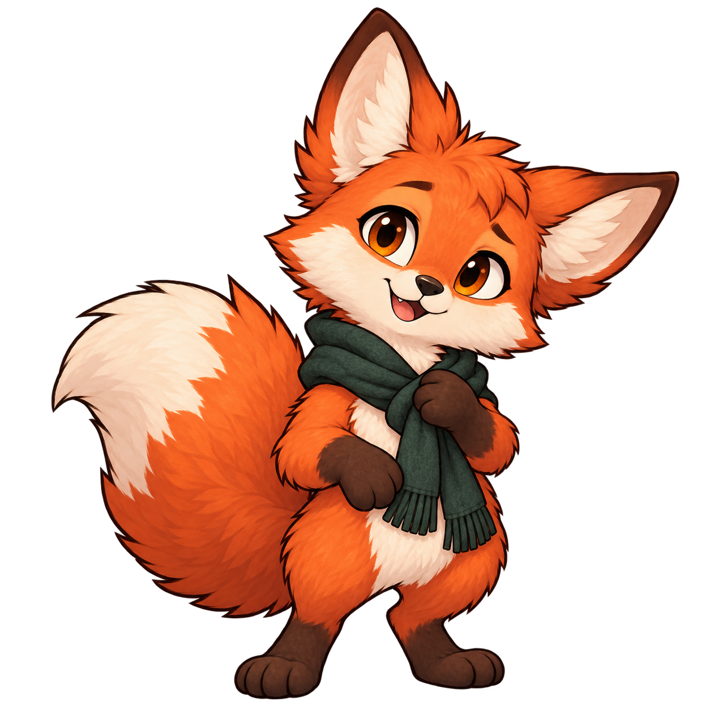
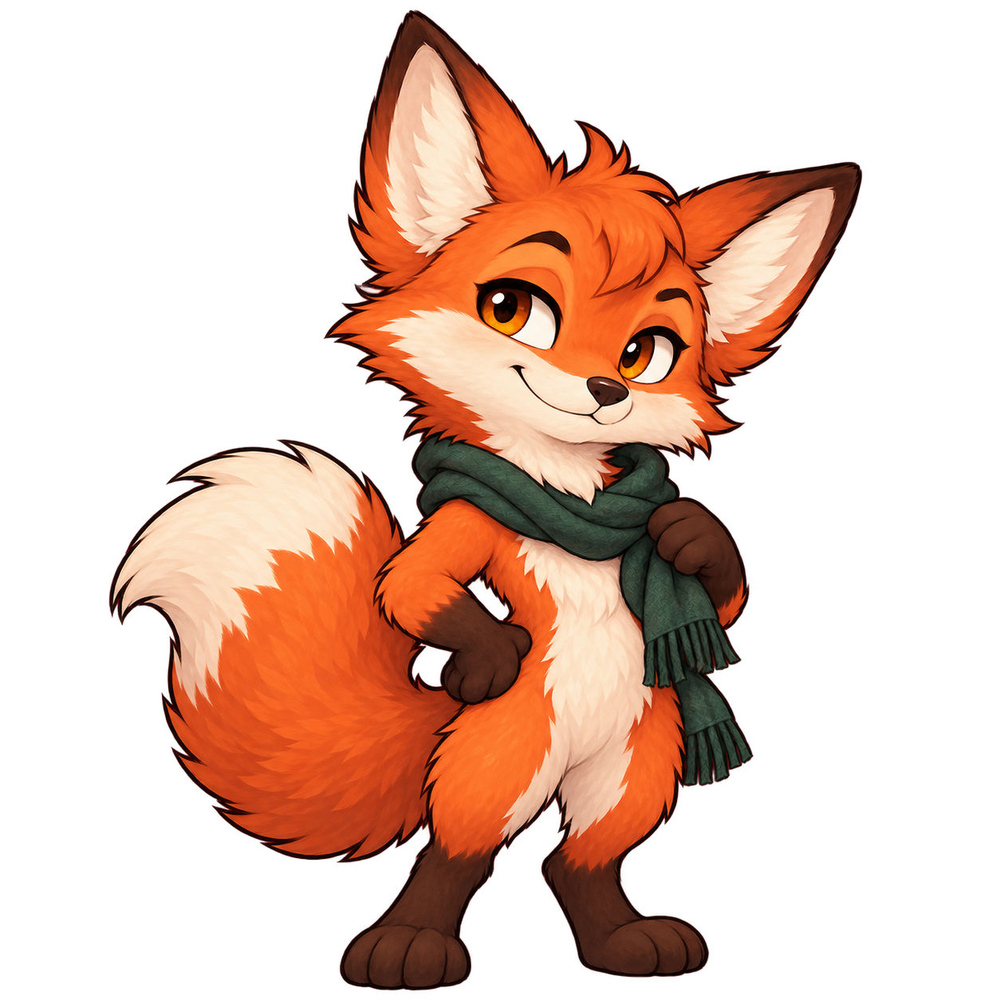
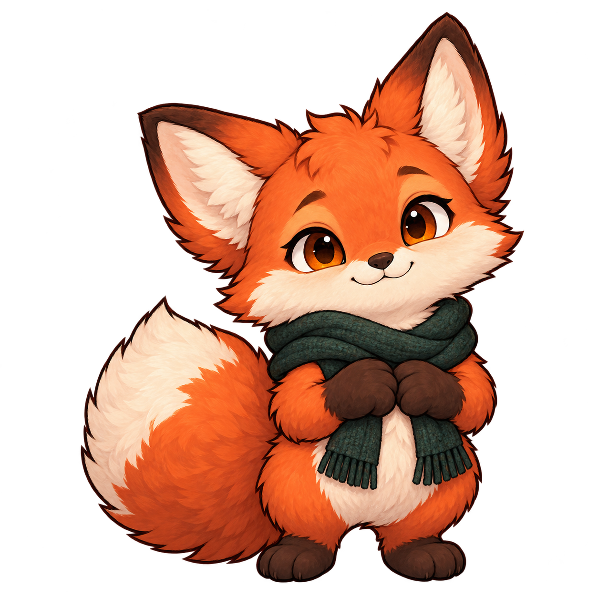
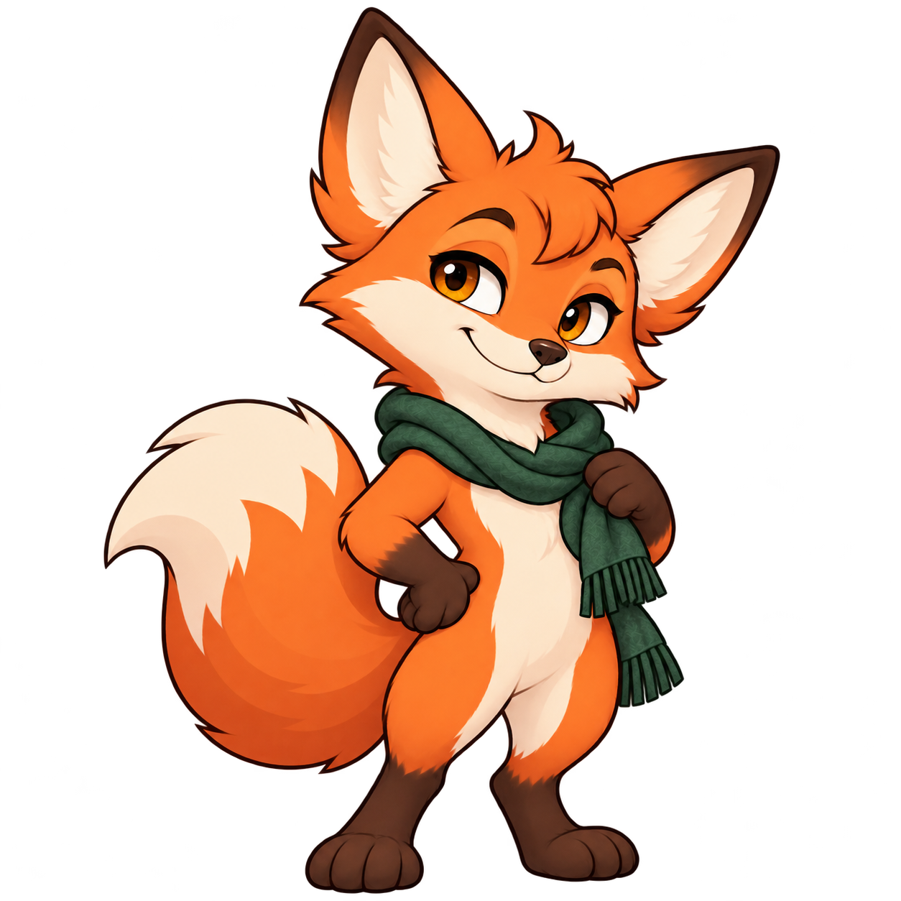
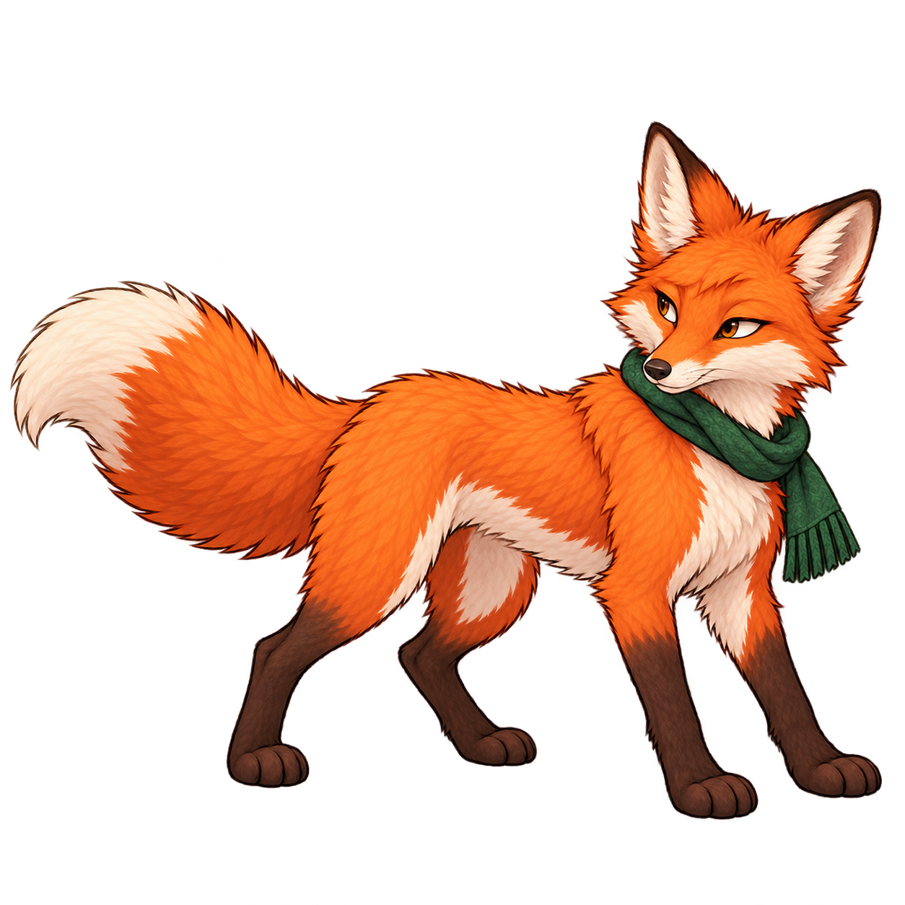
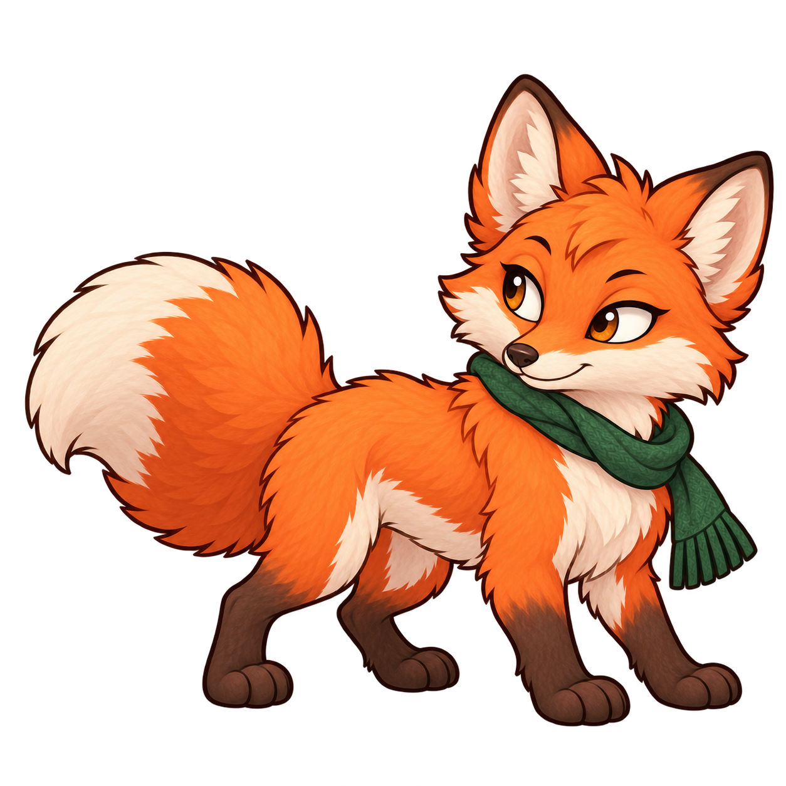
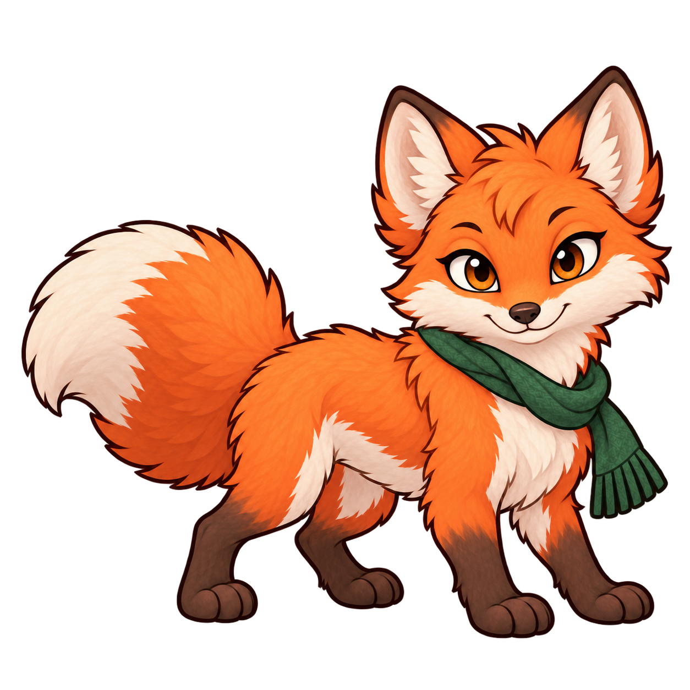

# Pip base sprite ideas

Three static concepts generated with the built-in imagegen tool on 2026-10-16. All retain Pip's orange fur, cream markings, dark paws and green wool shawl. Each explores a different face, silhouette and stance; these are design ideas without animations or runtime integration.

| 1. Curious | 2. Mischievous | 3. Gentle |
| --- | --- | --- |
|  |  |  |
| Eager head tilt, alert ears, open smile, paw holding his shawl. | Knowing crooked smile, relaxed eyelids, longer muzzle, paw on his hip. | Rounder cheeks and body, soft smile, clasped paws and snug shawl. |

Reference: [Pip's existing green wool shawl concept](../pip-green-wool-shawl-preview.png). [Exact generation prompts](prompts.md).

## Earlier upright design

Mischievous Pip with the original fur texture and tufts restored: `02-mischievous.png`. This was the earlier animated design; the app now uses the viewer-facing four-legged version below.

## Smoother alternative

Earlier exploration with smoother fur, fewer tufts and simpler shading, retaining his knowing smile, confident stance and green wool shawl. Single static concept generated with built-in imagegen.

[Exact refinement prompt](04-mischievous-smooth-prompt.md).

## Four-legged animal concept

Animal anatomy exploration: Pip on all fours with natural fox anatomy, a narrower muzzle, smaller eyes and a sly sideways glance. Keeps his orange/cream coat, dark paws and green neck wrap. This is a static base concept; the app still uses the upright animations above.

[Exact generation and refinement prompts](05-quadruped-mischievous-prompts.md), using built-in imagegen.

## Cartoon four-legged refinement

Cartoon style exploration: retain the four-legged animal stance and mischievous side glance, with rounder proportions, fuller cheeks, larger expressive eyes and simpler shading to match Hood and Crumb. Crumb's baseline supplied the cartoon style reference. Single static concept; runtime animations remain unchanged.

[Exact imagegen prompt](06-quadruped-cartoon-prompt.md).

## Default base looking at the viewer

Current app design: the cartoon four-legged Pip with his head turned toward the viewer and direct eye contact, keeping his playful smile, body pose, green wrap and tail. All ten animations and fitted headphones are integrated. See the [animation preview](../../pet-animations/README.md) and [retained runtime sources](../../../../Assets/Pip/source/README.md).

[Exact imagegen prompt](07-quadruped-viewer-prompt.md).

